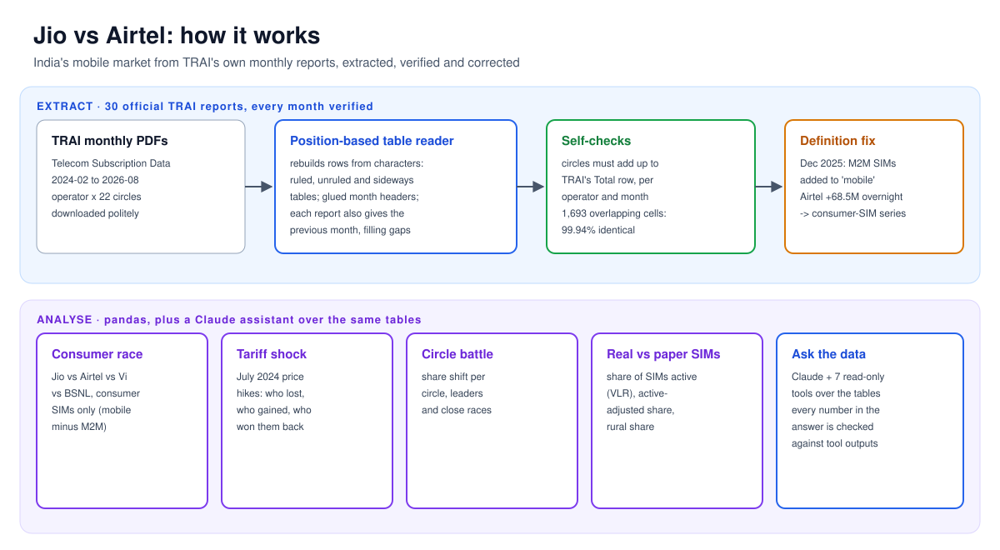
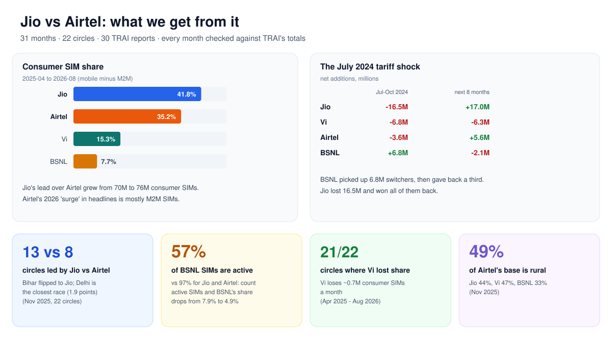
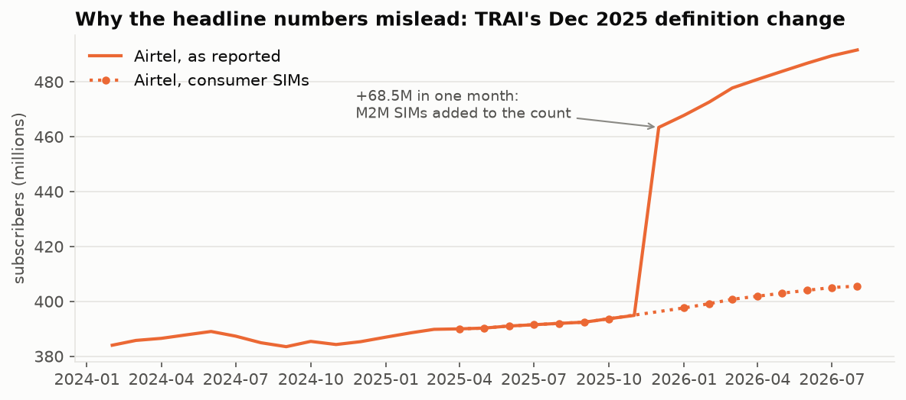
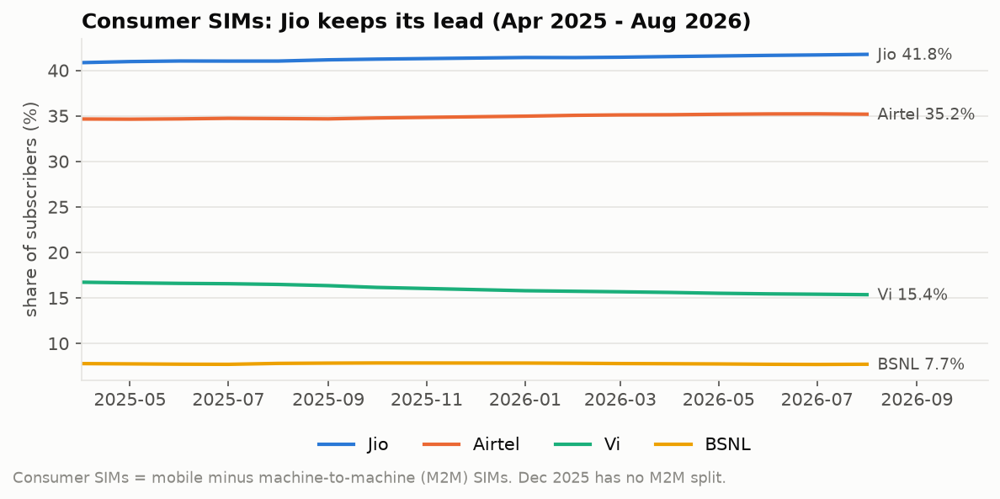
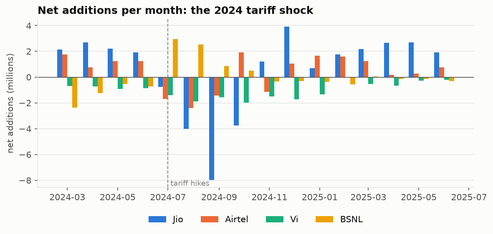
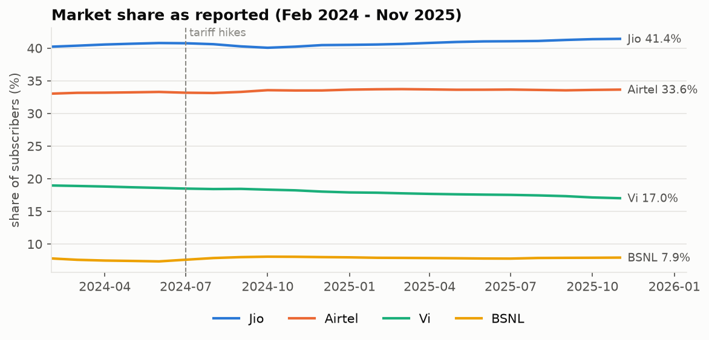
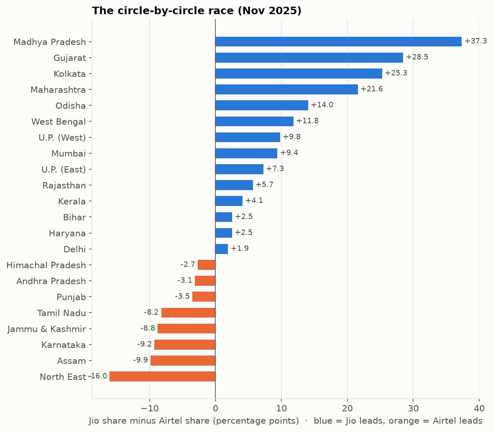
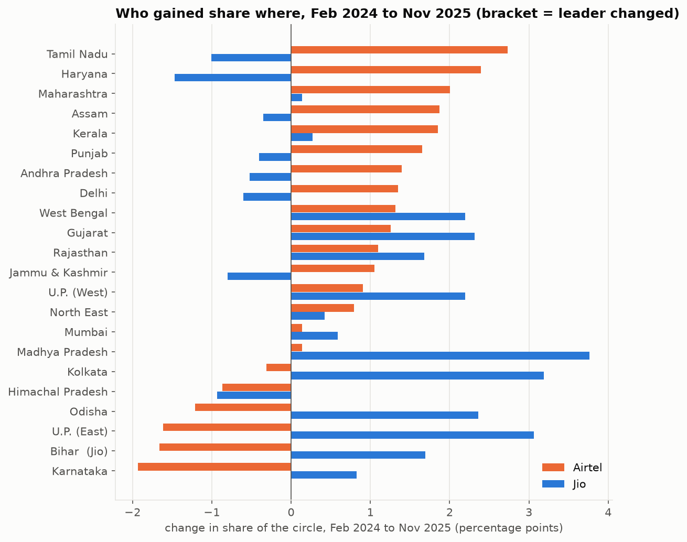
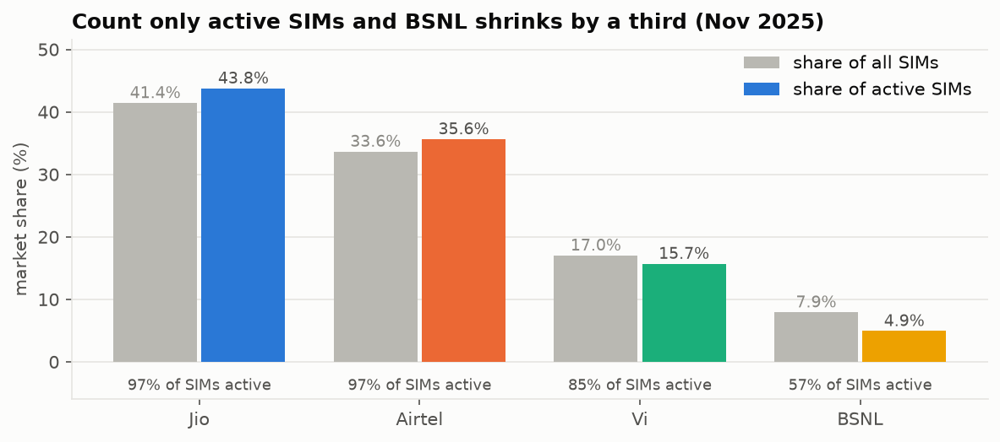

# 📶 Jio vs Airtel: India's mobile market from TRAI's own reports

**31 months (Feb 2024 to Aug 2026) of operator-by-circle subscriber data, extracted from 30 official TRAI PDF reports, checked against TRAI's own totals, and corrected for a definition change that makes the headline numbers misleading.** Who is really winning, where, what the 2024 tariff hikes did, and how many SIMs are actually in use.


---

## How it works



## What we get from it



## The data

**Source:** TRAI's monthly *Telecom Subscription Data* press releases ([trai.gov.in](https://trai.gov.in/release-publication/reports/telecom-subscriptions-reports)). Two annexures carry the operator x circle detail:

- **Annexure II:** wireless (mobile) subscribers for every operator in each of the 22 licensed service areas ("circles"), for the report month *and the previous month*.
- **Annexure III:** VLR as % of HLR, the share of an operator's SIMs that were active on the peak day.

The cleaned tables are in [`data/processed/`](data/processed) (public government data); the raw PDFs are not re-hosted.

**Getting it out of PDFs was the hard part.** Over 2.5 years TRAI used ruled tables, unruled tables, landscape tables whose characters are flagged as rotated, glued headers ("July-25August-25"), one fully scanned report, and one month whose numbers use a scrambled font. Instead of relying on table detection, the parser rebuilds rows from character positions and assigns every number to its nearest column anchor, so blank cells can't shift columns.

**Every month is verified:**

- For each operator, the 22 circles must add up to **TRAI's own Total row**, or that operator-month is rejected.
- Each report also lists the previous month, so a month whose own report can't be read is recovered from the next one. All 31 months are complete.
- 1,693 numbers appear in two reports (as "current" and later as "previous"): **99.94% are identical**.

### Why the headline numbers mislead



From the December 2025 report on, TRAI counts **wireless (mobile) = consumer SIMs + M2M (machine-to-machine) SIMs**. Airtel's count jumped by **68.5M in one month**, about the size of its M2M base, while Jio's, Vi's and BSNL's didn't (they already included theirs). Any chart of "Airtel overtaking Jio" built on the raw totals is mostly measuring car, meter and tracker SIMs. This project therefore uses two clean views:

| View | Months | What it is |
|---|---|---|
| **Reported** | Feb 2024 - Nov 2025 | as published; every operator's definition is unchanged, so circle-level comparisons are valid |
| **Consumer SIMs** | Apr 2025 - Aug 2026 | mobile minus M2M, using the M2M total and per-operator shares stated in each report. Check: Feb 2026 gives 1,138.9M consumer SIMs vs TRAI's stated 1,138.8M |

## Findings

### 1. On consumer SIMs, Jio's lead is growing



August 2026: **Jio 41.8%, Airtel 35.2%, Vi 15.4%, BSNL 7.7%**. Jio's lead over Airtel grew from **70M to 76M** consumer SIMs; Jio adds 1.35M a month, Airtel 0.97M (Apr 2025 to Aug 2026). Vi loses about 0.7M a month.

### 2. The July 2024 tariff shock



After Jio, Airtel and Vi raised prices in July 2024, the next four months saw **Jio lose 16.5M, Vi 6.8M and Airtel 3.6M subscribers, while BSNL gained 6.8M**. Over the following eight months Jio won all 17M back, Airtel recovered 5.6M, and BSNL gave back a third of its gain (-2.1M).



### 3. Circle by circle

| The race (Nov 2025) | Who gained where (Feb 2024 to Nov 2025) |
|---|---|
|  |  |

Jio leads **13 circles**, Airtel **8**, Vi 1 (Nov 2025). **Bihar flipped from Airtel to Jio**; **Delhi is the closest race** (1.9 points). Airtel gained most in Tamil Nadu (+2.7 pts), Haryana (+2.4) and Maharashtra (+2.0); Jio in Madhya Pradesh (+3.8), Kolkata (+3.2) and UP East (+3.1). Vi lost share in **21 of 22 circles**.

### 4. Real vs paper SIMs



About **97%** of Jio's and Airtel's SIMs are active on the peak day, Vi **85%**, BSNL only **57%**. Counting active SIMs only, BSNL's share falls from 7.9% to **4.9%**, and Jio's rises from 41.4% to 43.8%.

**Rural reach:** 49% of Airtel's base is rural, Vi 47%, Jio 44%, BSNL 33% (Nov 2025).

## Ask the data (Claude assistant)

`telecom-ask` answers plain-English questions with Claude and seven read-only tools over the verified tables: `market_share`, `trend`, `circle`, `rank_circles`, `active_sims`, `tariff_shock` and `data_notes`. It works straight after cloning, from `data/processed/`.

**Guardrail:** every number in the answer is checked against the numbers the tools actually returned. Anything that can't be found is reported as unverified, so a made-up statistic can't pass silently.

Real run, Claude Haiku 5.5, $0.0017:

```text
$ telecom-ask "Is Airtel catching up with Jio?" --model claude-haiku-5-5 --trace
  turn 1: trend({"operator": "Jio", "view": "consumer", "start": "2024-02", "end": "latest"})  [error]
  turn 1: market_share({"view": "consumer", "month": "latest"})
  turn 2: trend({"operator": "Jio", "view": "consumer", "start": "2025-04", "end": "latest"})
  turn 2: trend({"operator": "Airtel", "view": "consumer", "start": "2025-04", "end": "latest"})

No. On the consumer view (M2M SIMs excluded), Airtel is not catching up with Jio. Between April 2025 and
August 2026, Jio's share rose from 40.8% to 41.8% while Airtel's rose from 34.7% to 35.2%. Jio added about
1.35M subscribers a month against Airtel's 0.97M, and the subscriber gap grew from 69.7M to 75.8M.
  (caveat) The reported view, which counts M2M SIMs from December 2025, would show a ~68.5M one-month jump
           for Airtel that is not organic growth.

Number check: every number found in the tool outputs ✓
```

The tool error in turn 1 is deliberate: there's no consumer view before April 2025. Claude reads the error and retries with a valid start month.

| Question | What happened |
|---|---|
| *Who leads in Bihar and how has that changed since 2024?* | Jio 44.5% vs Airtel 42.0% (Nov 2025); Airtel led in Feb 2024. Every number verified. $0.0010 |
| *Which operator has the fastest 5G speeds in Delhi?* | "The data I can access does not cover network speeds…", with no guessing and 0 tool calls. $0.0004 |

**What the number check caught while building this:**

- **A first draft computed the Jio-Airtel gap itself** from rounded shares (6.1 points) and was flagged. The tools now return the exact gap (6.2 points), so it can be cited.
- **The assistant found a mistake in this README.** Jio's average monthly net additions were 1.35M, not the 1.55M first published. The original calculation skipped the two months missing from the consumer view.

## Quick start

```bash
git clone https://github.com/abpandey-dev/telecom-india.git && cd telecom-india
python -m venv .venv && source .venv/bin/activate
pip install -e ".[dev]"
pytest -q                                      # 14 tests: parser, analysis, assistant (fake Claude, no API calls)

python scripts/download_reports.py             # ~90 MB of TRAI PDFs into data/raw/ (needs data/raw/report_index.json)
PYTHONPATH=src python scripts/make_report.py   # parse + verify all reports, findings, charts
python scripts/make_diagrams.py

export ANTHROPIC_API_KEY=...                   # Claude assistant: about $0.001-0.002 a question on Haiku 5.5
telecom-ask "Who is winning in Tamil Nadu?" --model claude-haiku-5-5 --trace
```

## Project layout

```text
src/telecom/
  parse.py       # position-based table reader, Total-row self-checks, previous-month recovery, M2M from text
  analysis.py    # reported vs consumer views, tariff shock, circle shifts, active-adjusted share, rural share
  charts.py      # matplotlib charts (fixed colour per operator)
  assistant.py   # Claude "ask the data" assistant: 7 read-only tools, structured answer, number check
scripts/         # download_reports.py, make_report.py, make_diagrams.py, diagram_kit.py
data/processed/  # cleaned tables: mobile, active, rural, m2m (CSV)
docs/            # diagrams and charts
tests/           # PDF cleaning, glued headers, row rebuilding, M2M, consumer correction, assistant tools + loop
```

## Limits

- **Circle-level consumer SIMs aren't possible after Nov 2025.** TRAI gives M2M only nationally, so circle comparisons use Nov 2025, the last month before the break.
- **The consumer view has gaps.** December 2025 has no per-operator M2M split, so it's absent there; Apr 2025 is the first month with M2M shares.
- **VLR is a one-day snapshot.** Values above 100% (roaming SIMs) are capped at 100.
- **Mobile only.** Fixed wireless (5G FWA) and wireline are excluded. Reliance Communications (a few hundred legacy SIMs) is ignored.
- **Before mid-2024, "wireless" included a small FWA base.** That doesn't change the operator comparison.
- **No speed data.** TRAI's MySpeed analytics portal was unreachable during this project.

Data: Telecom Regulatory Authority of India, monthly Telecom Subscription Data press releases, Mar 2024 to Aug 2026.
